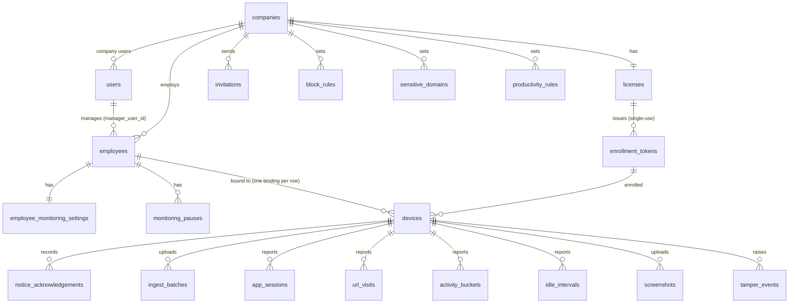

# Data model

Supabase PostgreSQL 15+. Source: WorkBeat Plan v3.5 §4.4, §5.3, §6 (D43, D45–D48); the agents' wire fields
(`backend-api-integration.md`, `local-store-schema.sql` in both agent repos); the prototype.
**The schema is [`db/migrations/`](../../../db/migrations/)** (`0001_init.sql`, `0002_spec_gaps.sql`, `0003_device_binding.sql`); this page
explains it. Self-check: [`db/tests/0001_init_test.sql`](../../../db/tests/0001_init_test.sql).

## Conventions

- Every tenant table has `company_id uuid NOT NULL` and row-level security. The API connects as
  `workbeat_api` and starts each request's transaction with `SET LOCAL app.scope` and, for
  tenants, `SET LOCAL app.company_id` (Plan §6.1):

  | `app.scope` | Sees |
  |---|---|
  | `tenant` | Only rows of `app.company_id` |
  | `staff` | `companies`, `licenses`, `users`, `invitations` (and the global tables). Never employees, devices or activity (D41) |
  | `system` | Everything. Cron jobs only |
  | unset | Nothing |

- Credentials are checked before a tenant is known, through `SECURITY DEFINER` functions that
  return only what the guard needs: `auth_device(key_hash)`, `auth_license(key_hash)`,
  `auth_enrollment_token(hash)`, `auth_invitation(hash)`, `company_by_host(host)`.
- Child rows reference parents by `(id, company_id)`, so a device can never point at another
  company's employee.
- Monthly partitions are never granted to `workbeat_api`; it reads them only through the parent
  table and its policy.
- Supabase's `anon` and `authenticated` roles get no table access. All access goes through the API.
- IDs are `uuid` (`gen_random_uuid()`), except ids the agent generates (UUIDv7: batch, screenshot,
  tamper), which are stored as sent and are the idempotency key (D13).
- Times are `timestamptz`. The agent's Unix ms are converted at ingest.
- Enums are `text` + `CHECK`, not Postgres enums (cheap to change in a migration).
- Secrets are stored as SHA-256 `*_hash` for lookup. Where an admin must see the secret again
  (license key, uninstall token) it is also stored encrypted (`*_ciphertext`, app-level key).
- Derived values are not stored: seats used, device status, `blocking_ends_at`, productivity
  category.

## Relations

`agent_releases` and `stripe_events` are global (no company).

## 1. Identity and access

### users
Mirror of Supabase `auth.users` plus what the API writes into `app_metadata` (D41). Staff and
company users in one table.

| Column | Type | Notes |
|---|---|---|
| id | uuid PK | = `auth.users.id` |
| email | citext NOT NULL UNIQUE | |
| name | text NOT NULL | |
| role | text NOT NULL | `super_admin` \| `company_admin` \| `manager` \| `it_admin` |
| company_id | uuid FK companies NULL | NULL **iff** `role = super_admin` (CHECK) |
| disabled_at | timestamptz NULL | |
| created_at | timestamptz NOT NULL | |

### invitations
| Column | Type | Notes |
|---|---|---|
| id | uuid PK | |
| company_id | uuid FK NULL | NULL only for a `super_admin` invite (staff invite staff, D41) |
| email | citext NOT NULL | |
| role | text NOT NULL | same CHECK pairing as `users` |
| token_hash | text NOT NULL UNIQUE | |
| invited_by | uuid FK users NOT NULL | |
| expires_at | timestamptz NOT NULL | |
| accepted_at, revoked_at | timestamptz NULL | |
| created_at | timestamptz NOT NULL | |

Unique open invite: `(company_id, email) WHERE accepted_at IS NULL AND revoked_at IS NULL`.

## 2. Company, licence, billing

### companies
| Column | Type | Notes |
|---|---|---|
| id | uuid PK | |
| name | text NOT NULL | |
| slug | text NOT NULL UNIQUE | ≤32 chars, lowercase-hyphen (PRD) |
| status | text NOT NULL | `trial` \| `active` \| `suspended` \| `expired` |
| suspended_reason | text NULL | `payment_failed` (D29) \| `staff` |
| suspended_at | timestamptz NULL | |
| expired_blocking_grace_days | int NOT NULL DEFAULT 30 | staff-editable (D36) |
| data_retention_days | int NOT NULL DEFAULT 90 | CHECK 30, 60 or 90 (0009) |
| idle_threshold_seconds | int NOT NULL DEFAULT 300 | D15 |
| min_agent_version | text NULL | company override; effective = max(this, global) |
| uninstall_token_hash | text NOT NULL | sent in policy (D19) |
| uninstall_token_ciphertext | bytea NOT NULL | IT reads it to uninstall |
| notice_text | text NOT NULL | collection notice (D25) |
| notice_version | int NOT NULL DEFAULT 1 | bumped by the API when the notice text changes (collection-notice) |
| policy_version | bigint NOT NULL | from global `policy_version_seq`, see §4 |
| custom_domain | citext NULL UNIQUE | |
| custom_domain_status | text NULL | `pending` \| `active` \| `failed` |
| custom_domain_token | text NULL | TXT `_workbeat.{domain}` = `verify-{token}` |
| custom_domain_checked_at, custom_domain_verified_at | timestamptz NULL | |
| alert_email | jsonb NOT NULL | `{roles[], types[], delivery: instant\|hourly\|daily}`; defaults to every event type (0002) |
| timezone | text NOT NULL DEFAULT 'UTC' | IANA name; bounds days in reports and digests (B19, 0002) |
| setup_completed_steps | text[] NOT NULL DEFAULT '{}' | onboarding checklist |
| created_at, updated_at | timestamptz NOT NULL | |

### licenses
One per company (prototype: "One license per company"). Holds the key and the subscription.

| Column | Type | Notes |
|---|---|---|
| id | uuid PK | |
| company_id | uuid FK UNIQUE NOT NULL | |
| key_hash | text NOT NULL UNIQUE | lookup for `/license/validate` |
| key_ciphertext | bytea NOT NULL | portal "copy licence key" |
| key_last4 | text NOT NULL | masked display |
| plan | text NOT NULL | `starter` \| `growth` \| `enterprise` |
| seat_limit | int NULL | NULL = unlimited (Enterprise) |
| screenshot_tier | text NOT NULL DEFAULT 'off' | `off` \| `light` \| `standard` \| `intensive` |
| trial_ends_at | timestamptz NULL | |
| current_period_end | timestamptz NULL | |
| expired_at | timestamptz NULL | `blocking_ends_at` = this + grace days (D36), computed |
| stripe_customer_id, stripe_subscription_id | text NULL UNIQUE | |
| key_reset_at | timestamptz NULL | |
| created_at, updated_at | timestamptz NOT NULL | |

The licence key is the only install credential (D43).

**Seats belong to the company, not the key.**
- Seats used = `count(devices) WHERE company_id = ? AND deactivated_at IS NULL AND released_at IS NULL`.
  Never stored, so it cannot drift.
- Releasing or deactivating a device frees its seat at once; the same key can install another
  device straight away (50/50 → release one → 49/50 → next install allowed).
- Reissuing the key updates only `key_hash`, `key_ciphertext`, `key_last4`, `key_reset_at` on the
  same row and deletes the licence's unused enrollment tokens. Devices and seats are untouched:
  50/50 on key A is 50/50 on key B.
- `/license/validate` refuses when no seat is free (`SEAT_LIMIT_EXCEEDED`). A token does not
  reserve a seat, so the database enforces the limit: trigger `devices_seat` locks the licence row
  and raises `SEAT_LIMIT_EXCEEDED` when a device inserted or reactivated would exceed it.

### stripe_events
Webhook idempotency. `id text PK` (Stripe `evt_…`), `type`, `payload jsonb`, `received_at`,
`processed_at NULL`.

## 3. People

### employees
| Column | Type | Notes |
|---|---|---|
| id | uuid PK | |
| company_id | uuid FK NOT NULL | |
| name | text NOT NULL | |
| email | citext NULL | unique per company among non-archived |
| department | text NULL | free text (PRD, prototype filter) |
| manager_user_id | uuid FK users NULL | one manager per employee (prototype) |
| archived_at | timestamptz NULL | "remove"; refused while the employee has a binding that is not released (D46, D48, 0003) |
| created_at, updated_at | timestamptz NOT NULL | |

### employee_monitoring_settings
1:1 with employee, created with it (D37).

| Column | Type | Notes |
|---|---|---|
| employee_id | uuid PK FK | |
| company_id | uuid FK NOT NULL | |
| activity, app_usage, window_titles, website_visits | bool NOT NULL DEFAULT true | |
| screenshot_interval_seconds | int NOT NULL | CHECK in (0, 600, 1800, 3600); API also requires 0 or ≥ the tier's interval |
| policy_version | bigint NOT NULL | from `policy_version_seq` |
| updated_by | uuid FK users NULL | |
| updated_at | timestamptz NOT NULL | |

### monitoring_pauses
| Column | Type | Notes |
|---|---|---|
| id | uuid PK | the agent's `pause_id` (D31) |
| company_id, employee_id | uuid FK NOT NULL | |
| starts_at, ends_at | timestamptz NOT NULL | CHECK ends_at > starts_at; extend = update ends_at |
| reason | text NOT NULL | `annual_leave` \| `sick_leave` \| `personal` \| `offsite_training` \| `other` (prototype) |
| note | text NULL | |
| created_by | uuid FK users NOT NULL | |
| cancelled_at | timestamptz NULL | |
| cancelled_by | uuid FK users NULL | |
| created_at | timestamptz NOT NULL | |

Any insert / extend / cancel bumps the employee's `policy_version` (D31).

## 4. Policy

### block_rules
`id`, `company_id`, `type` (`domain` \| `url`, D39), `pattern`, `reason NULL`, `created_by`,
`created_at`. Unique `(company_id, type, lower(pattern))`. Regex input is compiled to url
patterns or refused by the API before insert.

### sensitive_domains
`id`, `company_id`, `pattern`, `is_default bool` (seeded at signup from `packages/shared`),
`created_by NULL`, `created_at`. Unique `(company_id, lower(pattern))`.

### productivity_rules
`id`, `company_id`, `match_type` (`app` \| `domain`), `pattern`, `category` (`productive` \|
`neutral` \| `unproductive`), `created_at`. Unique `(company_id, match_type, lower(pattern))`.
Category is resolved at report time, never stored on activity rows (PRD).

### Policy version and ETag (replaces Plan §6.2 `policy_versions`)
- One global sequence `policy_version_seq`, bumped by triggers, plus the API on an agent release change:
  - block rules, sensitive domains, notice, idle threshold, min version, uninstall token →
    `companies.policy_version`;
  - an employee's settings or pauses → `employee_monitoring_settings.policy_version`;
  - publishing or withdrawing an agent release → every `companies.policy_version`, by the API in
    `staff` scope (agent-releases).
- A device's `policy_version` = `greatest(company, employee settings, device)`. It only grows,
  because every bump takes a new sequence value. `devices.policy_version` takes a value at insert
  and is never bumped: a binding's employee never changes (D48, 0003). The heartbeat compares it
  for an early fetch.
- `ETag` = hash of the resolved policy body. No table needed.

## 5. Devices and deployment

### enrollment_tokens
Internal only (D43). Issued by `/license/validate`, single-use, never shown to a person. There
are no install tokens in the portal.

| Column | Type | Notes |
|---|---|---|
| id | uuid PK | |
| company_id | uuid FK NOT NULL | |
| license_id | uuid FK NOT NULL | key reissue deletes this licence's unused tokens |
| token_hash | text NOT NULL UNIQUE | |
| employee_id | uuid FK NOT NULL | the employee picked in WorkBeat Setup; required (D47). The seat is filled at enroll, not here |
| expires_at | timestamptz NOT NULL | issued + 24 h |
| used_at | timestamptz NULL | set by `/devices/enroll`; a used token is refused |
| created_at | timestamptz NOT NULL | |

### devices
One row is one **binding**: the device ID the agent produces, the company's licence and one
employee (D48). The binding's employee never changes; to give the device to someone else it is
released and the next enrollment makes a new row.

| Column | Type | Notes |
|---|---|---|
| id | uuid PK | |
| company_id | uuid FK NOT NULL | |
| employee_id | uuid FK NOT NULL | the binding's employee, from the enrollment token; fixed for the row's life (D47, D48, 0003) |
| enrollment_token_id | uuid FK NULL | token of the latest enrollment; NULL if that token was later deleted |
| key_hash | text NULL UNIQUE | NULL after deactivate; replaced on re-enroll (D2) |
| key_issued_at | timestamptz NULL | |
| hostname, os_version, model, serial_number | text | |
| os | text NOT NULL | `macos` \| `windows` |
| arch | text NOT NULL | `x64` \| `arm64` |
| hardware_id | text NOT NULL | device ID the agent produces; format open (Q10). A new ID after a reinstall is a new binding (D48) |
| agent_version | text NOT NULL | |
| enrolled_via | text NOT NULL DEFAULT 'manual' | D40 |
| enrolled_at | timestamptz NOT NULL | |
| last_heartbeat_at | timestamptz NULL | |
| offline_since | timestamptz NULL | set by `/cron/heartbeat-check`, cleared on heartbeat |
| policy_version | bigint NOT NULL | taken at insert; never bumped (0003 drops `devices_policy_bump`) |
| reported_policy_version | bigint NULL | |
| helper_status, browser_access, permissions | jsonb NULL | latest heartbeat (D39, W11) |
| health | jsonb NULL | store_bytes, oldest_unsent_at, dropped, skips, restarts, upload failures, update_failure, uptime |
| active_pause_id | uuid NULL | as reported |
| notice_ack_version | int NULL | |
| deactivated_at | timestamptz NULL | seat freed, key cleared → 401 |
| released_at | timestamptz NULL | seat freed, key kept → 401 `DEVICE_RELEASED` (D38) |
| created_at, updated_at | timestamptz NOT NULL | |

- Unique `(company_id, hardware_id) WHERE released_at IS NULL`: one live binding per device ID.
  Re-enroll for the same employee reuses the row (D2); for another employee it is refused with
  `409 DEVICE_ASSIGNED` (D48); a released device's next enrollment is a new row (D38).
- A released device comes back only through a new Downloader install, which always brings a
  fresh single-use token (D38, D43).
- Status is derived: released → deactivated → tamper (open tamper event) → offline → online;
  plus outdated, permission pending, browser access pending, paused (Plan §5.9).

### notice_acknowledgements
Append-only legal evidence (D25). `id`, `company_id`, `device_id`, `employee_id`,
`notice_version`, `acknowledged_at`, `received_at`. Unique `(device_id, notice_version)`.

### agent_releases (global, staff-managed)
| Column | Type | Notes |
|---|---|---|
| id | uuid PK | |
| product | text NOT NULL | `agent` \| `downloader` |
| platform | text NOT NULL | `macos` \| `windows` |
| arch | text NOT NULL | `x64` \| `arm64` \| `universal` |
| version | text NOT NULL | |
| min_supported | text NOT NULL | the newest release's value is the global minimum |
| storage_path, sha256, signature | text NOT NULL | |
| size_bytes | bigint NOT NULL | |
| release_notes | text NULL | |
| published_by | uuid FK users NOT NULL | |
| released_at | timestamptz NOT NULL | |
| withdrawn_at | timestamptz NULL | |

Unique `(product, platform, arch, version)`.

## 6. Ingested data

`app_sessions`, `url_visits`, `activity_buckets`, `idle_intervals` are **range-partitioned by
month** on their time column (Plan §6.3). Each row carries `company_id`, `device_id` and
`employee_id` of the binding whose key uploaded it, so reports and manager scoping never join
through devices. Nothing is re-credited by time (D48).

### ingest_batches
Idempotency for `POST /agents/activity` (D13). PK `(device_id, batch_id)`, `company_id`,
`received_at`, `counts jsonb`. A repeat returns the stored result. Kept 14 days (agent retries
for at most 7, D7).

These four tables have no surrogate key and no foreign keys, to keep ingest cheap; integrity
comes from the device guard and `ingest_batches`. The agent's `session_user` is stored as
`os_user` (`session_user` is reserved in Postgres). Partitions exist from last month to two months
ahead (`ensure_month_partitions()`); records outside [now − 8 days, now + 1 day] are dropped and counted, and the batch is still accepted (B7).

### app_sessions
`company_id`, `device_id`, `employee_id`, `batch_id uuid`, `os_user`, `bundle_id`,
`app_name`, `process_name`, `window_title` ('' when withheld), `started_at`, `ended_at`,
`duration_seconds`, `clock_flag bool`. Index `(company_id, employee_id, started_at)`,
`(device_id, started_at)`.

### url_visits
`company_id`, `device_id`, `employee_id`, `batch_id`, `os_user`, `browser`, `url`, `domain`,
`visited_at`, `duration_seconds`.
Index `(company_id, employee_id, visited_at)`, `(company_id, domain, visited_at)`.

### activity_buckets
`company_id`, `device_id`, `employee_id`, `bucket_start`, `active_samples`,
`total_samples` (CHECK active ≤ total). PK `(device_id, bucket_start)`.

### idle_intervals
`company_id`, `device_id`, `employee_id`, `batch_id`, `os_user`, `started_at`, `ended_at`.

### screenshots
Not partitioned (low row count). `id uuid PK` (agent's), `company_id`, `device_id`,
`employee_id`, `captured_at`, `storage_path` (`{company_id}/{device_id}/{id}.jpg`),
`bytes`, `status` (`pending` \| `uploaded`), `uploaded_at NULL`, `created_at`.
Index `(company_id, employee_id, captured_at)`.

### tamper_events
Also the alerts feed. `id uuid PK` (agent's; server-made for `offline`), `company_id`,
`device_id`, `hostname` (snapshot, survives device removal — prototype), `event_type`
(`process_restart` \| `hosts_modified` \| `config_changed` \| `clock_tampered` \|
`permission_revoked` \| `offline` \| `duplicate_device_id`), `detail jsonb`, `repeat_count int`, `occurred_at`,
`received_at`, `resolved_at NULL` (offline: set when the heartbeat returns), `resolved_by NULL`,
`emailed_at NULL` (digests). Index `(company_id, occurred_at DESC)`,
`(device_id) WHERE resolved_at IS NULL`.

## 7. Retention

Nightly `/cron/cleanup`: per company, delete ingested rows and screenshot files older than
`data_retention_days` (batched deletes); drop whole monthly partitions older than the 90-day
maximum; delete `ingest_batches` older than 14 days and expired, unused `enrollment_tokens`.

## Added by 0002_spec_gaps.sql

Gaps found while writing the OpenSpec changes:

- `companies.timezone` (B19); `alert_email` defaults to every event type.
- `ingest_batches.body_sha256`, so a reused `Idempotency-Key` with another body answers `409`.
- `agent_releases.signature` nullable (Windows MSIs are unsigned, W35); `productivity_rules.created_by`.
- Exclusion constraint: an employee never has two live pauses that overlap.
- Removing an employee is blocked only by a device that still holds a seat (replaced by 0003).
- `auth_enrollment_token` returns `used` and `expired`; `company_by_stripe_customer()` finds a
  webhook's company.
- Staff helpers that return counts or delete only what they must: `company_seat_counts()`,
  `delete_unused_enrollment_tokens()`. Both refuse outside `staff` or `system` scope.
- `cron_ensure_month_partitions()` and `cron_drop_old_partitions()` run partition upkeep as the
  owner, only in `system` scope.

## Added by 0003_device_binding.sql

The device binding model (D48):

- Trigger refusing `UPDATE devices SET employee_id`: a binding's employee is fixed for its life.
  There is no reassign route.
- `devices_policy_bump` and its trigger are dropped; `devices.policy_version` no longer changes.
- `auth_device()` also returns `released_at`, so the upload routes can accept a released key for
  7 days after release (D45).
- `tamper_events.event_type` adds `duplicate_device_id`, written by the backend when a same-binding
  re-enroll arrives while the previous key heartbeated in the last 15 minutes (D46).
- Removing an employee is blocked while they have any binding with `released_at` NULL; a
  deactivated binding counts again (replaces 0002's rule).

## Not modelled (on purpose)

Reports and rollup tables (computed on read until load test says otherwise), invoices and cards
(read from Stripe), staff audit log, email outbox, heartbeat history (only the latest is kept).
