# Company lifecycle

How a company moves between `trial`, `active`, `suspended` and `expired`, who moves it, and what
each status means for portal users, agents, enrollment, billing and staff. Requirements:
[`company-status`](../openspec/changes/provision-companies/specs/company-status/spec.md),
[`subscription-sync`](../openspec/changes/provision-companies/specs/subscription-sync/spec.md),
[`company-signup`](../openspec/changes/provision-companies/specs/company-signup/spec.md),
[`staff-companies`](../openspec/changes/administer-platform/specs/staff-companies/spec.md).

Only Stripe events and two staff routes change `companies.status`. No company route can, even if a
body sends `status`. `ended` is not a status: it is what an `expired` company's agents do once
`blocking_ends_at` has passed.

```mermaid
stateDiagram-v2
    [*] --> trial: checkout.session.completed (starter)
    [*] --> active: checkout.session.completed (growth, enterprise)
    trial --> active: customer.subscription.updated (status active)
    active --> suspended_payment: invoice.payment_failed (renewal)
    trial --> suspended_staff: staff suspend
    active --> suspended_staff: staff suspend
    suspended_payment --> suspended_staff: staff suspend
    suspended_payment --> active: invoice.paid
    suspended_payment --> active: staff restore
    suspended_staff --> active: staff restore
    suspended_staff --> trial: staff restore (trial_ends_at ahead)
    trial --> expired: customer.subscription.deleted
    active --> expired: customer.subscription.deleted
    suspended_payment --> expired: customer.subscription.deleted
    suspended_staff --> expired: customer.subscription.deleted
    expired --> ended: time passes blocking_ends_at
    note right of ended: agent-side only; companies.status stays expired
    state "suspended (payment_failed)" as suspended_payment
    state "suspended (staff)" as suspended_staff
    state "ended (agent side)" as ended
```

## Transitions

| From | To | Trigger | Effect |
|---|---|---|---|
| — | `trial` | Stripe `checkout.session.completed`, Starter price | Company, slug, licence (10 seats, tier `off`), uninstall token, notice v1, default sensitive domains and productivity rules, first `company_admin`, welcome email. `trial_ends_at` = event + 14 days (B14) |
| — | `active` | Same event, Growth or Enterprise | As above; Growth gets 50 seats, Enterprise a NULL limit until staff set one |
| `trial` | `active` | `customer.subscription.updated` with the subscription `active` | Plan, seats, tier, `current_period_end` synced |
| `active` | `suspended` / `payment_failed` | `invoice.payment_failed` for a renewal | `suspended_at` set at once, no grace (D29) |
| any but `expired` | `suspended` / `staff` | `POST /v1/staff/companies/:id/suspend` | Also replaces a `payment_failed` reason |
| `suspended` / `payment_failed` | `active` | `invoice.paid` | `suspended_reason` cleared |
| `suspended` / `staff` | — | `invoice.paid` | Nothing: a staff suspension outlives payment |
| `suspended` (either) | `active` or `trial` | `POST /v1/staff/companies/:id/restore` | `trial` while `trial_ends_at` is ahead, else `active` |
| any but `expired` | `expired` | `customer.subscription.deleted` | `licenses.expired_at` = event time, `suspended_reason` cleared. Devices and seats untouched (D30) |
| `expired` | (ended) | Time: now > `expired_at` + grace days | No write. Agents lift blocking; offline detection skips the devices (D36) |
| `expired` | anything | Staff suspend or restore | `409 CONFLICT`, nothing changes |

Every Stripe event is verified on the raw body and processed once by its `id` in `stripe_events`.
A repeat answers `200` and runs nothing.

## What each status means

| | `trial` / `active` | `suspended` | `expired`, before `blocking_ends_at` | `expired`, after (ended) |
|---|---|---|---|---|
| Portal sign-in and reads | Yes | Yes | Yes | Yes |
| `GET /v1/company/status` | Status, `trial_ends_at` | Status, `suspended_reason` | `expired_at`, `blocking_ends_at` | Same |
| Billing routes | Yes | Yes (to pay) | Yes | Yes |
| Agent routes (`/v1/agents/*`) | Served | `402 COMPANY_SUSPENDED` | `402 LICENSE_EXPIRED` + `blocking_ends_at` | Same `402` |
| Heartbeat still recorded | Yes | Yes, under the `402` | Yes, under the `402` | Yes (agent sends hourly) |
| Agent behaviour (their spec) | Collect, block | Stop collecting, keep blocking, heartbeat only (D5) | As suspended | Blocking lifted, tamper off, heartbeat hourly |
| Offline alerts | Yes | Yes (heartbeats keep it online) | Yes | Never |
| `/license/validate`, enroll | Served, seats permitting | `402 LICENSE_SUSPENDED` | `402 LICENSE_EXPIRED` | `402 LICENSE_EXPIRED` |
| Uninstaller deactivate | `204` | `204`, never `402` (B17) | `204` | `204` |
| Staff suspend / restore | Suspend | Suspend (re-reason), restore | `409` | `409` |
| MRR estimate | `trial` 0; `active` seats × price | 0 | 0 | 0 |

`blocking_ends_at` is computed on every read, so a staff change to grace days moves it at once.
Example: expired 2026-12-01T00:00Z with 30 days → 2026-12-31T00:00Z. Staff set 60 days on day 40 →
20 days of blocking left.

## Billing changes inside a status

| Event | Effect |
|---|---|
| `customer.subscription.updated` | `plan`, `seat_limit` (10 or 50; Enterprise keeps the staff value), `screenshot_tier`, `current_period_end` |
| Tier lowered | Every employee interval above 0 and below the new tier interval is raised to it, same transaction (B11) |
| Tier `off` | Every employee interval set to 0 |
| Tier raised | Employee intervals unchanged |
| `PUT /v1/billing/screenshot-tier` | Schedules the change in Stripe for `current_period_end`; `licenses.screenshot_tier` waits for the event |
| Staff `PATCH .../license` | Enterprise only; a limit below seats used is `409` |

## Gaps found

- **No time-based trial end.** Nothing reads `trial_ends_at` to change status. The spec relies on
  Stripe sending `subscription.updated`, `payment_failed` or `subscription.deleted`. A trial whose
  first invoice fails is not covered: `payment_failed` is specified for "the renewal of an active
  company".
- **No way back from `expired`.** The plan says ended lasts until "the company subscribes again",
  but no spec moves `expired` to `active`; staff restore is `409`, and a new checkout creates a new
  company.
- **Portal writes while suspended or expired** are not specified; only reads and billing are
  required to keep working.
- **Plan downgrade below seats used** (Growth → Starter with 30 devices) is not specified. The
  trigger only refuses new seats, so existing devices keep working over the limit.
- **Signup scope.** Signup inserts a company before any tenant exists, and only `/cron/*` may use
  `system` scope (B2). The spec does not say which scope the webhook transaction uses.
