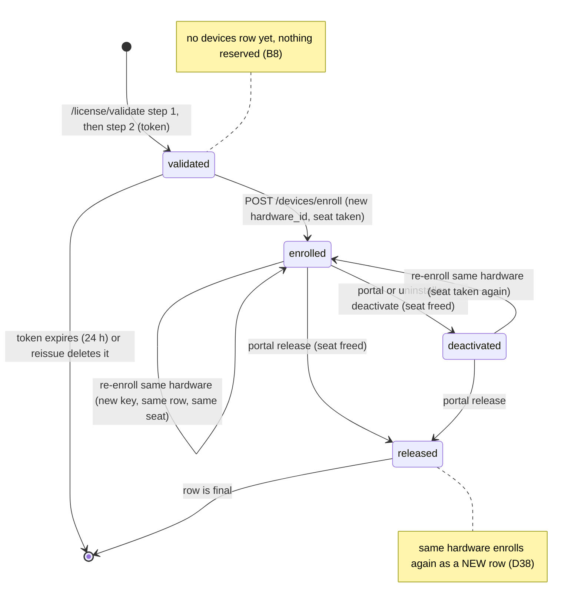

# Device lifecycle and seats

A device's life as the backend sees it, from the Downloader's first call to release, and how the
seats it holds are counted. The agent's view is in each agent repository's
`docs/domain/device-lifecycle.md`. Requirements:
[`license-validation`](../openspec/changes/enroll-devices/specs/license-validation/spec.md),
[`device-enrollment`](../openspec/changes/enroll-devices/specs/device-enrollment/spec.md),
[`device-authentication`](../openspec/changes/enroll-devices/specs/device-authentication/spec.md),
[`device-lifecycle`](../openspec/changes/enroll-devices/specs/device-lifecycle/spec.md),
[`staff-license-reissue`](../openspec/changes/administer-platform/specs/staff-license-reissue/spec.md).

## Transitions

| Step | Route and caller | Writes | Seat |
|---|---|---|---|
| Validate, step 1 | `POST /v1/license/validate`, `X-License-Key`, no `employee_id` | Nothing. Returns `company_name`, non-archived `employees[]` | Checked, not reserved |
| Validate, step 2 | Same, with `employee_id`, `os`, `arch` | One `enrollment_tokens` row (hash, employee, 24 h). Returns token, `package_url`, `package_sha256` | Checked, not reserved |
| Enroll, new hardware | `POST /v1/devices/enroll`, `Bearer <token>` | New `devices` row for the token's employee, `key_hash`, token `used_at`. `201` with `device_id`, `device_key` | Taken by trigger `devices_seat` |
| Re-enroll, same hardware (D2) | Same route, a known `hardware_id` with `released_at` NULL | Same row: new `key_hash`, employee from token, identity refreshed, `deactivated_at` cleared | Kept if held; taken again if deactivated |
| Reassign | `POST /v1/devices/:id/reassign`, `company_admin` / `it_admin` | `employee_id`; trigger raises `devices.policy_version` (B5) | Unchanged |
| Deactivate, portal | `POST /v1/devices/:id/deactivate`, user token | `deactivated_at`, `key_hash` NULL (D6) | Freed |
| Deactivate, uninstaller | Same route, `X-Device-Key` of that device | As above; `204` (D19) | Freed, even when suspended or expired (B17) |
| Release | `POST /v1/devices/:id/release`, `company_admin` / `it_admin` | `released_at`; `key_hash` kept so the agent can be told (D38) | Freed |
| After release | Enroll with a fresh token | New row, new `device_id`; the released row is left as it was | Taken |

The unique index `devices_hardware (company_id, hardware_id) WHERE released_at IS NULL` is what
makes re-enrollment reuse the row and makes a released device's return a new row.

## Seats

- **Counted, never stored.** Seats used = the company's devices with `deactivated_at` and
  `released_at` both NULL (D43, B4). No column holds a count.
- **Trigger-enforced.** `devices_seat` runs before a device starts holding a seat (insert, or
  clearing `deactivated_at`). It locks the `licenses` row, counts, and raises
  `SEAT_LIMIT_EXCEEDED`. A NULL limit is unlimited.
- **Validation reserves nothing.** Two Macs may both pass validation for the last seat; the second
  enrollment gets `403 SEAT_LIMIT_EXCEEDED` and its token stays unused.
- **Freed by deactivate or release** at once; the same key can install another device next.
- **Belong to the company, not the key.** A reissue changes only the key.
- **Employee required (D44).** Every token, and so every device, names a non-archived employee.
  There is no unassigned queue. An employee with a seat-holding device cannot be archived
  (`409 EMPLOYEE_HAS_DEVICES`).

### Worked example: reissue at 50/50

| # | Action | Seats | Result |
|---|---|---|---|
| 1 | Growth company, 50 devices enrolled with key A; one token T issued, unused | 50/50 | — |
| 2 | Staff reissue → key B (same `licenses` row, `key_reset_at` set) | 50/50 | T deleted; admins emailed key B |
| 3 | Every device heartbeats | 50/50 | `200`: device keys are untouched |
| 4 | Downloader with key A | 50/50 | `404 LICENSE_NOT_FOUND` |
| 5 | Agent enrolls with T | 50/50 | `404 ENROLLMENT_TOKEN_INVALID` |
| 6 | Downloader with key B | 50/50 | `403 SEAT_LIMIT_EXCEEDED` |
| 7 | IT releases one laptop | 49/50 | Laptop's next call `401 DEVICE_RELEASED` |
| 8 | Key B validate + enroll a new Mac | 50/50 | `201` |

## Every 401, 402, 403 and 404 a device or Downloader can get

| Route | Status `code` | When |
|---|---|---|
| validate | `404 LICENSE_NOT_FOUND` | Missing or unknown key, including the key before a reissue |
| validate | `402 LICENSE_SUSPENDED` / `LICENSE_EXPIRED` | Company suspended / expired, checked right after the key |
| validate | `403 SEAT_LIMIT_EXCEEDED` | No free seat, at either step |
| validate step 2 | `404 EMPLOYEE_NOT_FOUND` | `employee_id` archived or of another company |
| enroll | `404 ENROLLMENT_TOKEN_INVALID` | Unknown token, or deleted by reissue or `/cron/token-expiry` |
| enroll | `403 ENROLLMENT_TOKEN_EXHAUSTED` | Token already used, including a concurrent second use |
| enroll | `403 ENROLLMENT_TOKEN_EXPIRED` | Unused token past 24 h |
| enroll | `402 LICENSE_SUSPENDED` / `LICENSE_EXPIRED` | Company state, after the token check |
| enroll | `422 VALIDATION_FAILED` | Body `employee_id` differs from the token's |
| enroll | `404 EMPLOYEE_NOT_FOUND` | Token's employee archived since validation |
| enroll | `403 SEAT_LIMIT_EXCEEDED` | Trigger refused the seat (new row or deactivated row) |
| agent routes, deactivate | `401 DEVICE_REVOKED` | Missing, unknown, replaced (re-enrolled) or deactivated key |
| agent routes, deactivate | `401 DEVICE_RELEASED` | Key of a released device; nothing is written |
| agent routes | `402 COMPANY_SUSPENDED` | Company suspended; heartbeat still recorded |
| agent routes | `402 LICENSE_EXPIRED` + `blocking_ends_at` | Company expired; heartbeat still recorded |
| deactivate (device key) | `403 FORBIDDEN` | `:id` is not the key's own device |

Order on agent routes: key lookup (`auth_device`) → released → company status → tenant scope. A
`device_id` or `company_id` in a body never changes which device the request acts for.

## Gaps found

- **Deactivate under suspension.** [enroll-devices design.md](../openspec/changes/enroll-devices/design.md)
  decision 4 says the uninstaller gets `402 COMPANY_SUSPENDED`; the `device-authentication` spec,
  B17 and agent-contract.md say it is exempt. The spec should win; the design is stale.
- **Deactivate status code.** `device-lifecycle` says the uninstaller gets `204`; the
  `device-authentication` scenario for a suspended company says `200`.
- **Stale design risk.** The same design says `auth_enrollment_token` returns only `usable`;
  `0002_spec_gaps.sql` already returns `used` and `expired`.
- **`devices.enrollment_token_id`** is `NOT NULL` in data-model.md but nullable (`ON DELETE SET
  NULL`) in `0001_init.sql`.
- **Archive rule wording.** data-model.md and the manage-employees proposal say "an unreleased
  device" blocks archive; `employee-directory` and `0002` say a device that is neither released
  nor deactivated.
