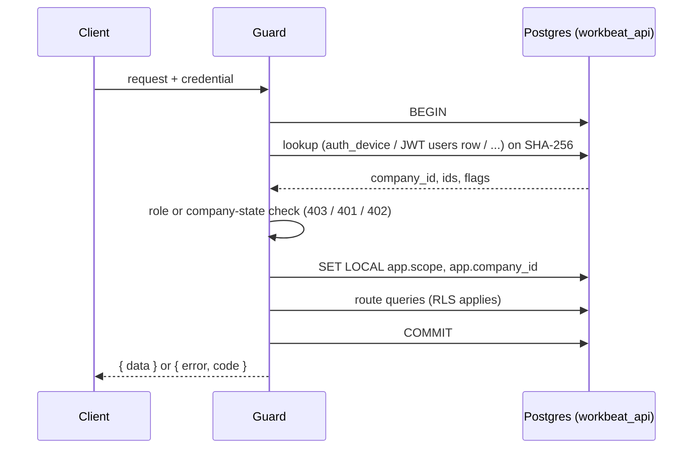

# Tenancy and scopes

How each request is bound to one company, the staff area or a system job, and what each role can
reach. Requirements:
[`request-scope`](../openspec/changes/establish-api-foundation/specs/request-scope/spec.md),
[`role-access`](../openspec/changes/authenticate-users/specs/role-access/spec.md),
[`user-authentication`](../openspec/changes/authenticate-users/specs/user-authentication/spec.md),
[`manager-teams`](../openspec/changes/manage-employees/specs/manager-teams/spec.md),
[`staff-data-boundary`](../openspec/changes/administer-platform/specs/staff-data-boundary/spec.md).

## Scopes (B2)

Every request runs in one transaction that first runs `SET LOCAL app.scope` and, in tenant scope,
`SET LOCAL app.company_id`. The API connects as `workbeat_api`, which is subject to RLS.

| `app.scope` | Who | Sees |
|---|---|---|
| `tenant` | Company users, agents, Downloader | Only rows of `app.company_id` |
| `staff` | `super_admin` | `companies`, `licenses`, `users`, `invitations`, `agent_releases`, `stripe_events` |
| `system` | `/cron/*` only (B10) | Everything |
| unset | A bug | Nothing |

Route code filters too; RLS is the backstop, so a missed filter returns nothing.
`/cron/cleanup` alone commits in many short transactions, each setting `system` first (B15).

## Where `company_id` comes from

Never from a body, query or path. Always from the credential:

| Credential | Resolved by | Gives |
|---|---|---|
| Supabase JWT | Signature check, then the `users` row (`app_metadata` must match, not disabled) | `role`, `company_id` |
| `X-Device-Key` | `auth_device(sha256)` | `device_id`, `company_id`, `employee_id`, `released` |
| `X-License-Key` | `auth_license(sha256)` | `license_id`, `company_id` |
| Enrollment token | `auth_enrollment_token(sha256)` | `token_id`, `company_id`, `employee_id`, `used`, `expired` |
| Invitation token | `auth_invitation(sha256)` | `invitation_id`, `company_id`, `email`, `role`, `usable` |
| Host name | `company_by_host(host)` | `{slug}.workbeat.io` or an active custom domain |
| Stripe customer | `company_by_stripe_customer(id)` | `company_id` for subscription events |

## Database functions

| Function | Kind | Guard | Purpose |
|---|---|---|---|
| `auth_*`, `company_by_host`, `company_by_stripe_customer` | `SECURITY DEFINER` lookups (B3) | Grant to `workbeat_api` only | Find a credential before a tenant is known; return only what the guard needs |
| `company_seat_counts()` | Staff helper | Raises unless `staff` or `system` | Seat counts per company without reading `devices` |
| `delete_unused_enrollment_tokens(license_id)` | Staff helper | Same | Key reissue clears tokens without tenant access |
| `cron_ensure_month_partitions`, `cron_drop_old_partitions` | Cron helpers | `require_system_scope()` | Partition upkeep as the table owner |

The API never needs a bypass-RLS connection on a request path.

## RLS policies

| Tables | Policy |
|---|---|
| `employees`, `employee_monitoring_settings`, `monitoring_pauses`, `block_rules`, `sensitive_domains`, `productivity_rules`, `enrollment_tokens`, `devices`, `notice_acknowledgements`, `ingest_batches`, four activity tables, `screenshots`, `tamper_events` | `company_id = app_company_id()` or `system`. Staff see nothing |
| `licenses`, `users`, `invitations` | Own company, or `staff`, or `system` |
| `companies` | `id = app_company_id()`, or `staff`, or `system` |
| `agent_releases`, `stripe_events` | No RLS; no tenant data |

Partitions are never granted to `workbeat_api`, so they are read only through the parent and its
policy. Supabase `anon` and `authenticated` get nothing.

## What each role can reach

R = read, W = write, T = own team only, — = `403`.

| Area | `company_admin` | `manager` | `it_admin` | `super_admin` |
|---|---|---|---|---|
| Onboarding checklist | RW | — | RW | — |
| Licence key, uninstall token, min version | RW | — | RW | — |
| Devices, rollout, deactivate / release / reassign | RW | — | RW | — |
| Block list | RW | R | RW | — |
| Employee directory | RW | R (T) | R (`id`, `name`, `email`, `department`, B18) | — |
| Monitoring settings, pauses | RW | R (T) | — | — |
| Notice acknowledgements | R | — | — | — |
| Reports, calendar, timesheets, exports | R | R (T) | — | — |
| Screenshots | R | R (T) | — | — |
| Productivity rules, sensitive domains | RW | R | — | — |
| Alerts feed | R + resolve | R (T) | R + resolve | — |
| Dashboard | All sections | Own team, no seats | Devices, alerts | — |
| Settings, notice, timezone, billing, team, custom domain | RW | — | — | — |
| `/v1/staff/*` | — | — | — | RW |

## Manager team scoping (B12)

- An employee has at most one manager: `employees.manager_user_id`, set only by a `company_admin`,
  and only to an enabled `manager` of the same company.
- Every manager read filters `employees`, and every row keyed by `employee_id`, to that team.
- Activity rows carry `employee_id` stamped at ingest, so the filter never joins through devices.
- Outside the team answers `404 NOT_FOUND`, the same as an unknown ID. Managers write nothing.

## Why staff never see employee data (D41)

Staff run billing and support. Employee activity belongs to the customer, and there is no
impersonation. So `staff` scope gets zero rows from every tenant table, seat counts come from a
count-only function, no staff response carries a name, hostname, URL or screenshot, and a CI test
calls every route with a `super_admin` token against two seeded companies.

## How a request flows

## Gaps found

- **Block list read.** `role-access` gives the block list to `company_admin` and `it_admin`;
  `block-rules` lets a `manager` read it. The table above follows `block-rules`.
- **Wrong 404 code.** `calendar-and-timesheets` answers a non-team employee with
  `404 EMPLOYEE_NOT_FOUND` (an agent code); `role-access` says `404 NOT_FOUND`.
- **Webhook scope.** Stripe routes are neither user nor cron routes. `subscription-sync` runs in
  tenant scope via `company_by_stripe_customer`; how signup inserts a company in tenant scope
  before it exists is not specified.
- **CLAUDE.md rule 1** lists token, device key and host name as tenant sources; `request-scope`
  also lists the licence key. Enrollment, invitation tokens and the Stripe customer are sources
  too.
